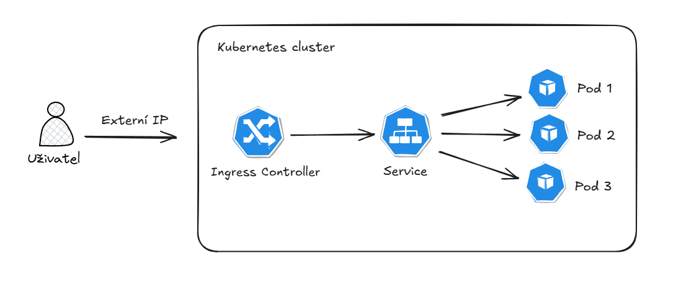
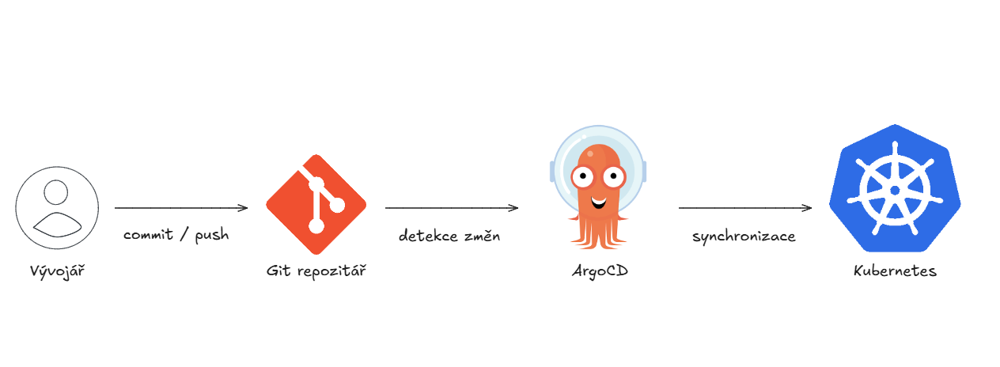
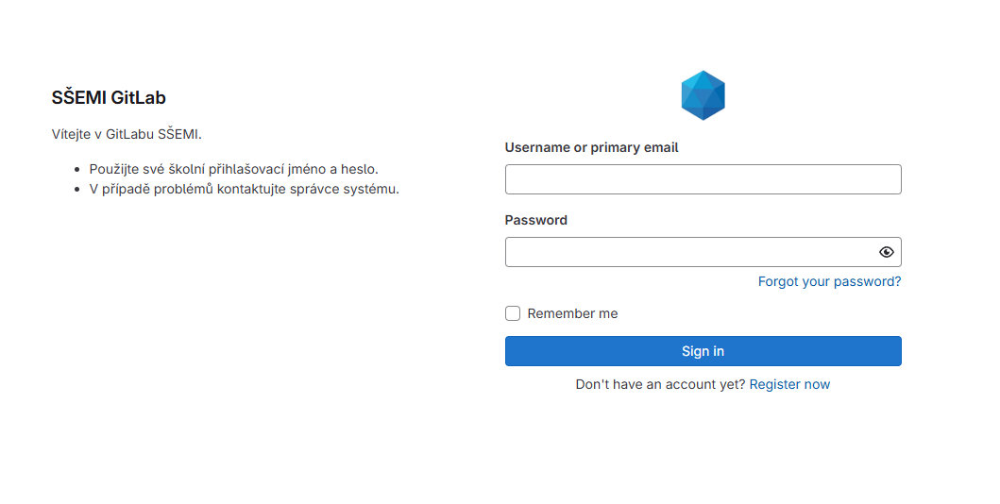
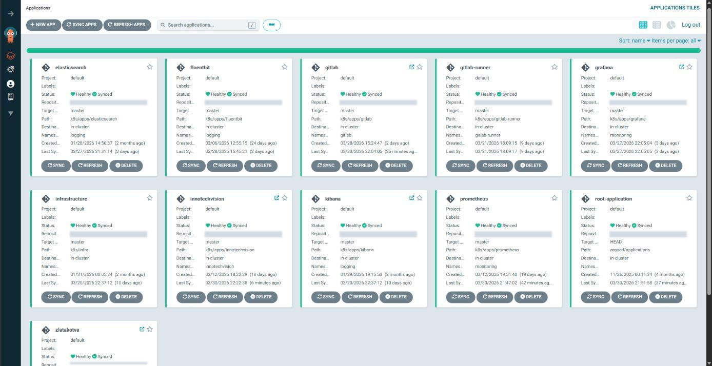

# Kubernetes Lab

A 2025/2026 team graduation project by [SSEMI-TRADERS](https://github.com/SSEMI-TRADERS). We built a self-managed MicroK8s cluster that hosted web applications developed by other students for their graduation projects, alongside GitOps, monitoring, and logging services.

This is a historical school project. The public configurations use placeholders for internal addresses and credentials.

## My Contributions

I set up MicroK8s on Ubuntu Server, configured Kubernetes Services, MetalLB and NGINX Ingress, and organized the platform namespaces. I integrated the infrastructure for the team's services and helped verify deployment status and Ingress access in the lab.

## Tech Stack

| Technology | Role |
| --- | --- |
| MicroK8s / Kubernetes | Runs applications and platform services on the lab server. |
| MetalLB / NGINX Ingress | MetalLB supplies a LAN address for the entry Service; Ingress routes requests to app Services. |
| GitLab / GitLab Runner / Helm | Repository hosting and CI/CD components, including a Helm chart for the runner. |
| Argo CD | Synchronizes Kubernetes manifests from Git. |
| Prometheus / Grafana | Collect and visualize metrics. |
| Fluent Bit / Elasticsearch / Kibana | Configured pipeline for collecting, indexing, and viewing logs. |

## Manifests

- [Infrastructure manifests](k8s/infra/) and [application manifests](k8s/apps/)
- [Namespaces](k8s/infra/bootstrap/namespaces.yaml), [MetalLB pool](k8s/infra/metallb-pool.yaml), and [LoadBalancer Service](k8s/infra/ingress-lb.yaml)
- [GitLab Ingress example](k8s/apps/gitlab/ingress.yaml)
- [Argo CD root Application](argocd/root-application.yaml) and [child Applications](argocd/applications/)

## Architecture & Screenshots

*Original Kubernetes networking diagram from the graduation thesis. The lab used MetalLB for the external address.*

*GitOps illustration from the graduation defense.*

*GitLab sign-in page from the graduation thesis.*

*Historical Argo CD deployment overview — school Kubernetes lab, 2026.*

## Team Credits

[Upstream team repository](https://github.com/SSEMI-TRADERS/devops-k8s-portfolio)

| Contributor | Responsibility |
| --- | --- |
| [Konstantyn Huzil](https://github.com/Kostahe) | MicroK8s setup, Kubernetes networking, Ingress, MetalLB, and infrastructure integration. |
| [Jachym Pantoflicek](https://github.com/jasanjasanjasan) | GitLab deployment, persistent storage, and GitOps integration. |
| [Jakub Ryba](https://github.com/KubaCZ007) | Argo CD configuration, app-of-apps structure, and environment management. |
| Tomas Mejsnar | Prometheus and Grafana monitoring. |
| [Petr Spor](https://github.com/TheWeth) | Elasticsearch, Kibana, and Fluent Bit logging. |
