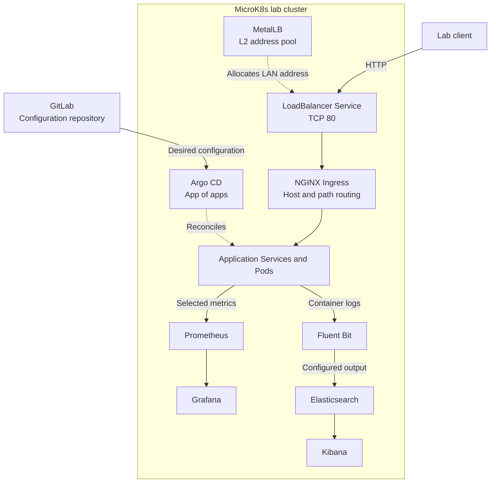

# Kubernetes Lab: Cluster Setup and Networking

**Engineering case study by [Konstantyn Huzil](https://github.com/Kostahe)**

Team graduation project, 2025/2026

## Project Overview

Our team built a self-managed MicroK8s lab to test how student web apps could share infrastructure with GitOps, monitoring, and logging services. The cluster hosted web applications developed by other students as part of their graduation projects.

**My focus:** I set up MicroK8s and integrated the networking that made selected services reachable on the lab network: Kubernetes Services, MetalLB, and NGINX Ingress.

[My contributions](#my-contributions) | [Architecture walkthrough](docs/architecture.md) | [Lessons learned](docs/lessons-learned.md)

## Architecture Diagram

The diagram separates configuration sync from application traffic. GitLab represents the original configuration source; the team also ran a GitLab deployment as a lab trial. The logging arrows show the configured data path. See the [architecture walkthrough](docs/architecture.md) for prerequisites and integration limits.

GitOps illustration from the graduation defense

*Figure from slide 4 of the graduation defense. The original Czech labels describe the GitOps flow.*

## Tech Stack

| Technology | Role in the lab |
| --- | --- |
| **MicroK8s / Kubernetes** | Workload runtime on Ubuntu Server, with namespaces and hostpath storage for lab persistence. |
| **MetalLB** | Allocates a LAN address for the shared LoadBalancer Service using an L2 address pool. |
| **NGINX Ingress** | Routes requests by hostname and path to internal Kubernetes Services. |
| **Argo CD** | Reconciles the Git configuration through a root Application and child Applications. |
| **GitLab / GitLab Runner / Helm** | Git repository platform and CI/CD components. The snapshot includes a Helm chart for the runner. |
| **Prometheus / Grafana** | Metrics collection and visualization. |
| **Fluent Bit / Elasticsearch / Kibana** | Configured pipeline for collecting, indexing, and inspecting container logs. |

## My Contributions

- **Cluster setup:** Installed MicroK8s on Ubuntu Server, enabled ingress and storage add-ons, and checked node and system Pod readiness.
- **Networking:** Configured internal Services, a shared [LoadBalancer entry point](k8s/infra/ingress-lb.yaml), a [MetalLB address pool and L2 advertisement](k8s/infra/metallb-pool.yaml), and host-based [Ingress routing](k8s/apps/dexd-bazar/app/ingress.yaml).
- **Infrastructure integration:** Organized [platform namespaces](k8s/infra/bootstrap/namespaces.yaml) and prepared the runtime for the team's GitLab, GitOps, monitoring, logging, and application workloads.
- **Lab validation:** Checked deployment state in Argo CD and verified that selected services were reachable through Ingress during the original lab session.

## Historical Validation

| Check | What the original lab recorded |
| --- | --- |
| Argo CD deployment state | Selected applications were `Synced` and `Healthy` at the time of observation. |
| Ingress reachability | Selected services responded through the configured Ingress routes. |

The graduation report (section 3.5) and defense presentation (slide 9) document these point-in-time checks.

*Historical Argo CD deployment overview — school Kubernetes lab, 2026.*

## Technical Documentation

- **[Architecture](docs/architecture.md):** GitOps flow, routing from the LAN entry point to application Pods, observability, and lab rebuild prerequisites.
- **[Lessons and trade-offs](docs/lessons-learned.md):** Shared ingress, bootstrap dependencies, hostpath storage, and what still needs verification.

Start with the [root Application](argocd/root-application.yaml), [infrastructure manifests](k8s/infra/), or [application manifests](k8s/apps/). The existing [branding assets](assets/) and [reference links](zdroje/) are also retained.

## Team Credits

This was a collaborative school project by [SSEMI-TRADERS](https://github.com/SSEMI-TRADERS). The [upstream public snapshot](https://github.com/SSEMI-TRADERS/devops-k8s-portfolio) preserves the team's work.

| Contributor | Responsibility |
| --- | --- |
| [Konstantyn Huzil](https://github.com/Kostahe) | MicroK8s setup, Kubernetes networking, Ingress, MetalLB, and infrastructure integration. |
| [Jachym Pantoflicek](https://github.com/jasanjasanjasan) | GitLab deployment, persistent storage, and GitOps integration. |
| [Jakub Ryba](https://github.com/KubaCZ007) | Argo CD configuration, app-of-apps structure, and environment management. |
| Tomas Mejsnar | Prometheus and Grafana monitoring. |
| [Petr Spor](https://github.com/TheWeth) | Elasticsearch, Kibana, and Fluent Bit logging. |

## Limitations and Security Notes

This public snapshot replaces internal domains, addresses, and credentials with placeholders. A rebuild requires compatible controllers, usable Git and image sources, lab-specific DNS and address ranges, and Secrets supplied outside Git. The tracked entry Service exposes TCP port 80; the Ingress TLS settings alone do not establish external HTTPS.

This was a school proof of concept. The historical checks do not establish production readiness, availability targets, or a successful redeployment of the sanitized snapshot. The case study was written after graduation and leaves the deployment manifests unchanged.
